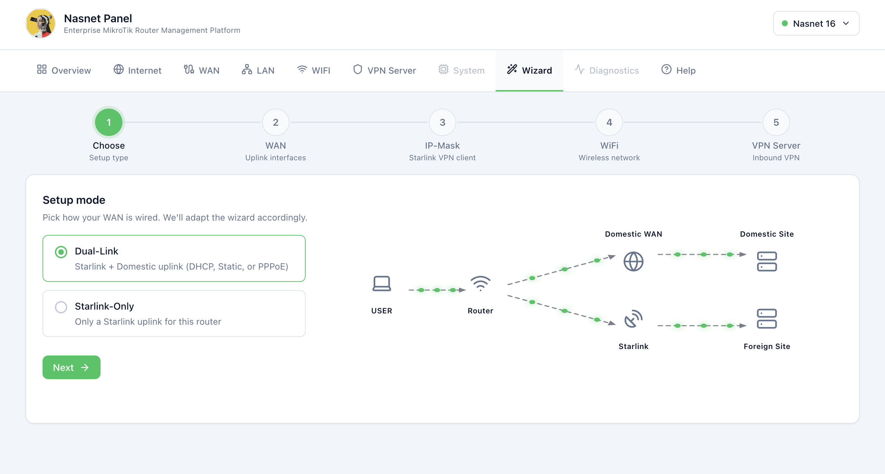
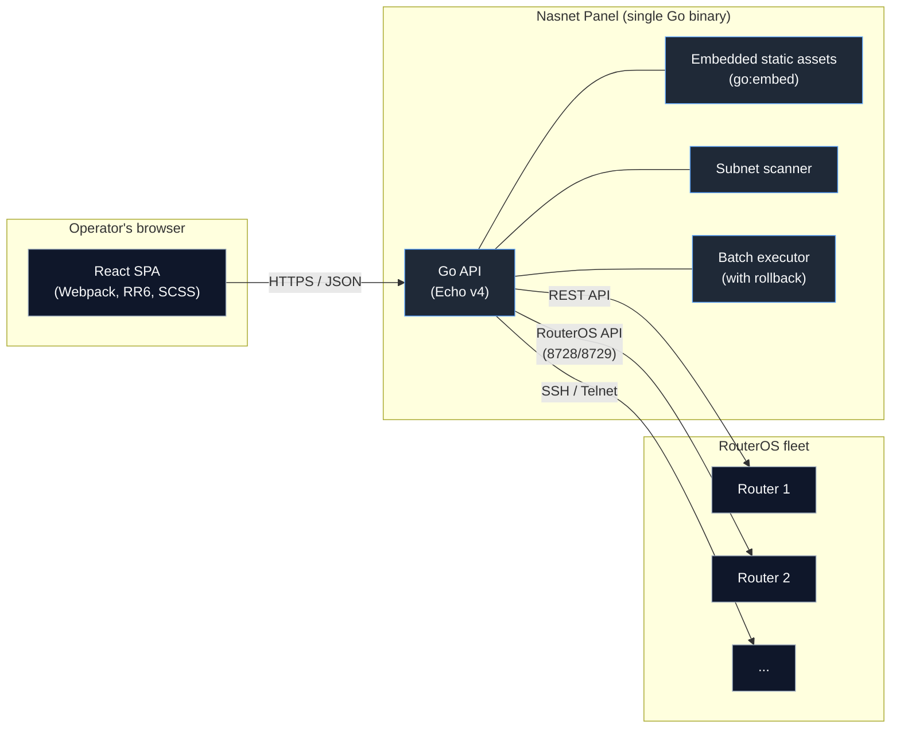

<div align="center">


# Nasnet Panel

**یک پنل وب مدرن برای مدیریت دستگاه‌های MikroTik RouterOS.**
React SPA + Go API، در قالب یک کانتینر کوچک و واحد که همه‌جا اجرا می‌شود، حتی مستقیماً روی خود روتر.

[](https://github.com/nasnet-community/nasnet-panel/actions/workflows/pr-check.yml)
[](https://github.com/nasnet-community/nasnet-panel/actions/workflows/release.yml)
[](https://github.com/nasnet-community/nasnet-panel/releases)
[](LICENSE)
[](https://nodejs.org/)
[](https://golang.org/)
[](https://mikrotik.com/)
[](https://github.com/nasnet-community/nasnet-panel/pkgs/container/nasnet-panel)

[English](README.md) - فارسی

[وب‌سایت](https://www.joinnasnet.com/fa/) - [قابلیت‌ها](#features) - [معماری](#architecture) - [نصب](#installation) - [پیکربندی](#configuration) - [توسعه](#development) - [مشارکت](#contributing)

</div>

---

<div dir="rtl">

## وضعیت

در حال توسعه فعال، پیش از نسخه 1.0. ممکن است APIهای عمومی، پیکربندی و ساختار داده‌ها روی دیسک بین نسخه‌ها تغییر کند. در محیط عملیاتی (production) از یک نسخه‌ی تگ‌شده استفاده کنید.

## درباره‌ی پروژه

</div>

<div align="center">



</div>

<div dir="rtl">

Nasnet Panel (نام فایل اجرایی `nasnet-panel`) یک رابط وب خودمیزبان برای مدیریت روترهای MikroTik RouterOS است. این برنامه از طریق REST API، API بومی RouterOS (پورت‌های 8728/8729)، SSH و Telnet با RouterOS ارتباط برقرار می‌کند و در صورت نیاز به‌طور خودکار به پروتکل دیگر سوئیچ می‌کند. فرانت‌اند یک React SPA است؛ بک‌اند یک سرویس کوچک Go است که درخواست‌ها را به روتر می‌رساند، زیرشبکه‌ها را برای یافتن دستگاه‌های MikroTik اسکن می‌کند و دستورهای دسته‌ای را همراه با بازگردانی (rollback) اختیاری اجرا می‌کند.

<a id="features"></a>

## قابلیت‌ها

<table>
<tr>
<td width="50%">

### داشبورد لحظه‌ای

معیارهای زنده‌ی سیستم، مصرف CPU و حافظه، پایش ترافیک و وضعیت اینترفیس‌ها در یک نگاه.

### مدیریت شبکه

پیکربندی اینترفیس‌ها، جدول‌های ARP، آدرس‌دهی IP، مسیریابی و مدیریت سرور DHCP.

### مرکز کنترل VPN

تونل‌های IPsec، L2TP، PPTP، WireGuard، OpenVPN و SSTP همراه با پایش peerها و کلاینت‌ها.

### مدیریت بی‌سیم

کنترل اینترفیس‌های WiFi، پروفایل‌های امنیتی، فهرست کلاینت‌های متصل و پایش قدرت سیگنال.

</td>
<td width="50%">

### پیکربندی فایروال

قوانین Filter، NAT و mangle با ویرایشگر بصری و ردیابی زنده‌ی اتصال‌ها.

### کشف روتر

اسکن زیرشبکه برای شناسایی خودکار دستگاه‌های MikroTik، همراه با تشخیص سرویس‌ها روی پورت‌های رایج.

### عملیات دسته‌ای

اجرای گروهی دستورها با نمایش پیشرفت، حالت dry-run و بازگردانی خودکار در صورت خطا.

### پشتیبانی از چند پروتکل

REST API، API بومی RouterOS (پورت‌های 8728/8729)، SSH و Telnet با جایگزینی خودکار.

</td>
</tr>
</table>

<a id="architecture"></a>

## معماری

</div>



<div dir="rtl">

بک‌اند با چند پروتکل با RouterOS صحبت می‌کند و به‌طور خودکار جایگزین را امتحان می‌کند: ابتدا REST API، سپس API بومی RouterOS و بعد SSH/Telnet. SPA توسط همان فایل اجرایی Go ارائه می‌شود که JSON API را هم در اختیار می‌گذارد؛ بنابراین فقط یک پردازه برای اجرا و یک پورت برای باز کردن لازم است.

<a id="installation"></a>

## نصب

چهار روش پشتیبانی‌شده، به ترتیب میزان استفاده‌ی مورد انتظار.

### ۱. Docker (پیشنهادی)

CI انتشار، با هر تگ یک ایمیج چندمعماری در GitHub Container Registry منتشر می‌کند.

</div>

```bash
docker run -d \
  --name nasnet \
  -p 8080:80 \
  --restart unless-stopped \
  ghcr.io/nasnet-community/nasnet-panel:latest
```

<div dir="rtl">

آدرس `http://localhost:8080` را باز کنید.

برای شبکه‌ی میزبان (host networking) تا کانتینر مستقیماً به روترهای شبکه‌ی محلی شما دسترسی داشته باشد:

</div>

```bash
docker run -d --name nasnet --network=host --restart unless-stopped \
  ghcr.io/nasnet-community/nasnet-panel:latest
```

<div dir="rtl">

#### docker compose

</div>

```yaml
services:
  nasnet:
    image: ghcr.io/nasnet-community/nasnet-panel:latest
    container_name: nasnet
    network_mode: host
    environment:
      PORT: 80
    restart: unless-stopped
```

<div dir="rtl">

پلتفرم‌های پشتیبانی‌شده: `linux/amd64`، `linux/arm64`، `linux/arm/v7`. ایمیج روی busybox+musl و با فایل اجرایی Go فشرده‌شده با UPX ساخته می‌شود و برای اینکه به‌اندازه‌ی کافی کوچک بماند تا داخل کانتینر RouterOS اجرا شود بهینه شده است. یک endpoint به نام `/health` پشتوانه‌ی `HEALTHCHECK` داخلی است.

### ۲. MikroTik RouterOS با `scripts/install.sh`

`scripts/install.sh` برنامه‌ی Nasnet Panel را به‌صورت کامل داخل یک کانتینر RouterOS نسخه‌ی 7 مستقر می‌کند: بررسی‌ها، شبکه‌بندی، آپلود ایمیج، اجرای کانتینر و راستی‌آزمایی سلامت.

**پیش‌نیازها**

- RouterOS نسخه‌ی v7.24 یا جدیدتر با بسته‌ی `container` نصب‌شده و فعال.
- `device-mode` کانتینر فعال باشد (در اولین فعال‌سازی به تأیید فیزیکی نیاز دارد: دکمه‌ی reset یا راه‌اندازی مجدد سرد).
- حافظه‌ی خارجی (اسکریپت به‌صورت پیش‌فرض از `disk1/` استفاده می‌کند).
- حداقل ۳۰ مگابایت RAM آزاد روی روتر.
- ابزارهای محلی: `bash`، `curl`، `ssh`، `scp`، `sha256sum` (یا `shasum`).

**اجرا**

</div>

```bash
# Interactive: prompts for router IP, user, password
bash scripts/install.sh

# Non-interactive: pass an env-style config
cat > router.env <<'EOF'
ROUTER_IP=192.168.88.1
ROUTER_USER=admin
ROUTER_PASS=secret
EOF
bash scripts/install.sh --config router.env

# Or via env var
SSHPASS=secret bash scripts/install.sh --config router.env
```

<div dir="rtl">

پس از پایان، پنل روی `http://<router-ip>:8080` در دسترس است (یا هر `--lan-port` که داده باشید).

**پرچم‌ها (Flags)**

| پرچم                 | کاربرد                                                              |
| -------------------- | ------------------------------------------------------------------- |
| `--dry-run`          | هر کاری که اسکریپت انجام می‌داد را چاپ می‌کند، بدون هیچ تغییری.     |
| `--uninstall`        | کانتینر، شبکه‌بندی، قوانین NAT و tarball آپلودشده را حذف می‌کند.    |
| `--config <file>`    | فایل به‌سبک env با `ROUTER_IP=`، `ROUTER_USER=` و `ROUTER_PASS=`.   |
| `--version <tag>`    | تگ انتشار یا `snapshot` (پیش‌فرض: آخرین انتشار).                    |
| `--image-tar <path>` | به‌جای دانلود دارایی انتشار، از یک tar محلی استفاده می‌کند.         |
| `--lan-port <port>`  | پورت سمت LAN برای قانون dst-nat (پیش‌فرض `8080`).                   |
| `--no-rollback`      | در صورت خطا وضعیت ناقص را برنمی‌گرداند (برای اشکال‌زدایی مفید است). |
| `-v`, `--verbose`    | خروجی مفصل.                                                         |
| `-h`, `--help`       | نمایش راهنمای استفاده.                                              |

**نصب‌کننده گام‌به‌گام چه می‌کند**

1. پورت‌های Winbox (8291) و SSH (22) روتر را بررسی می‌کند و اطلاعات ورود را می‌گیرد.
2. نسخه‌ی RouterOS، معماری (`arm` / `arm64` / `x86_64`)، RAM آزاد، بسته‌ی `container` و `device-mode container` را بررسی می‌کند.
3. tar آماده‌ی کانتینر را برای معماری شناسایی‌شده (`amd64` / `arm64` / `armv7`) از آخرین انتشار تگ‌شده دانلود می‌کند (یا از تگی که با `--version` داده شده، یا از انتشار شناور `snapshot` با `--version snapshot`) و checksum آن را راستی‌آزمایی می‌کند. اگر آخرین انتشار پیدا نشود با خطا متوقف می‌شود.
4. شبکه‌بندی کانتینر را پیکربندی می‌کند: `veth-nasnet-panel` روی `192.168.50.2/24`، بریج `containers` روی `192.168.50.1/24`، masquerade از نوع `srcnat` برای `192.168.50.0/24` و `dstnat` از `--lan-port` به veth.
5. tarball را با SCP روی `disk1/` می‌فرستد، کانتینر را با `start-on-boot=yes` اضافه و اجرا می‌کند.
6. آدرس `http://<router>:<lan-port>/health` را تا ۱۲۰ ثانیه بررسی می‌کند؛ در صورت شکست، لاگ‌های کانتینر را نمایش می‌دهد.

برای حذف همه‌چیز: `bash scripts/install.sh --uninstall --config router.env`.

**ترجیح می‌دهید دستی نصب کنید؟**

راهنمای کامل نصب را در [`scripts/INSTALL.md`](scripts/INSTALL.md) ببینید. این راهنما هم اسکریپت خودکار و هم روش دستی از طریق Winbox یا ترمینال RouterOS را توضیح می‌دهد و تمام دستورهای شبکه‌بندی، فایروال و کانتینری را که نصب‌کننده اجرا می‌کند بازتولید می‌کند.

### ۳. MikroTik RouterOS با نصب‌کننده‌ی گرافیکی (Windows و macOS)

اگر ترجیح می‌دهید از ترمینال استفاده نکنید، یک نصب‌کننده‌ی دسکتاپ، Nasnet Panel را به‌صورت کانتینر روی روتر RouterOS نسخه‌ی 7 مستقر می‌کند. این برنامه روی Windows و macOS اجرا می‌شود و همان کار `scripts/install.sh` را از طریق یک پنجره‌ی راهنما انجام می‌دهد.

**دریافت**

نصب‌کننده‌ی مناسب رایانه‌ی خود را همراه با checksum به‌صورت `.sha256` از [صفحه‌ی Releases](https://github.com/nasnet-community/nasnet-panel/releases) دانلود کنید:

- Windows: `nasnet-panel-installer-windows-<version>.exe`
- macOS: `nasnet-panel-installer-macos-<version>.dmg`

**چه کاری انجام می‌دهد**

1. به روتر متصل می‌شود و سیستم را بررسی می‌کند.
2. یک مسیر اینترنت (uplink) برای روتر آماده می‌کند، در صورت تمایل با اتصال به یک شبکه‌ی WiFi که روتر آن را اسکن می‌کند.
3. در صورتی که RouterOS از نسخه‌ی لازم قدیمی‌تر باشد آن را به‌روزرسانی می‌کند و `device-mode` کانتینر را فعال می‌کند.
4. ایمیج کانتینر را برای معماری روتر دانلود و آپلود می‌کند، شبکه‌بندی کانتینر را برپا می‌کند و کانتینر را اجرا می‌کند.
5. سلامت پنل را بررسی می‌کند و LAN baseline را اعمال می‌کند.

در صورت شکست نصب، هر گام برگردانده می‌شود و نصب‌کننده می‌تواند آنچه را برپا کرده نیز حذف کند. به‌طور پیش‌فرض آخرین انتشار تگ‌شده نصب می‌شود. گزینه‌های پیشرفته اجازه می‌دهند snapshot توسعه، یک تگ انتشار مشخص یا یک tar ایمیج محلی را انتخاب کنید.

فهرست کامل گام‌ها و روش ساخت نصب‌کننده از روی سورس را در [`graphical-installer/README.md`](graphical-installer/README.md) ببینید.

### ۴. از روی سورس (توسعه)

</div>

```bash
git clone https://github.com/nasnet-community/nasnet-panel.git
cd nasnet-panel
npm install
npm run dev:all
```

<div dir="rtl">

فرانت‌اند: `http://localhost:3000`. بک‌اند: `http://localhost:8080`. سرور توسعه، درخواست‌های API را به‌طور خودکار به بک‌اند پروکسی می‌کند.

به Node.js نسخه‌ی 20 به بالا و Go نسخه‌ی 1.26 به بالا نیاز دارد.

<a id="configuration"></a>

## پیکربندی

بک‌اند پیکربندی خود را از متغیرهای محیطی می‌خواند. فایل `backend/.env.example` را ببینید.

| متغیر         | پیش‌فرض                      | کاربرد                                                                                                    |
| ------------- | ---------------------------- | --------------------------------------------------------------------------------------------------------- |
| `PORT`        | `8080` (dev)، `80` (کانتینر) | پورت TCP که API و SPA توکار روی آن گوش می‌دهند.                                                           |
| `HOST`        | `0.0.0.0`                    | آدرس bind.                                                                                                |
| `ENVIRONMENT` | `development`                | مقدار `production` مسیرهای مخصوص توسعه (به‌ویژه Swagger UI) را غیرفعال می‌کند.                            |
| `BACKEND_URL` | _خالی_                       | زمان build. خالی یعنی SPA از URLهای نسبی به origin خودش استفاده می‌کند (حالت رایج برای build توکار).      |
| `SENTRY_DSN`  | DSN پروژه‌ی Nasnet           | زمان build. مقصدی که رابط پنل گزارش خطا را به آن می‌فرستد. با رشته‌ی خالی، گزارش خطا از build حذف می‌شود. |

## گزارش خطا

وقتی رابط پنل با یک خطای مدیریت‌نشده روبه‌رو شود، یک گزارش خرابی می‌فرستد تا بتوانیم باگ‌هایی را که کاربران هرگز گزارش نمی‌کنند پیدا و رفع کنیم. این قابلیت به‌طور پیش‌فرض روشن است و هر زمان از صفحه‌ی Diagnostics و به‌ازای هر مرورگر می‌توان آن را خاموش کرد.

سه نکته که باید دقیق بدانید:

- گزارش‌دهی فقط در buildهای production اجرا می‌شود، یعنی ایمیج کانتینر منتشرشده. `npm run dev` در حالت توسعه build می‌کند و SDK هرگز راه‌اندازی نمی‌شود؛ پس توسعه‌ی محلی هیچ چیزی ارسال نمی‌کند.
- گزارش را مرورگر شما می‌فرستد، نه روتر. خود MikroTik هرگز به Sentry وصل نمی‌شود.
- گزارش شامل خطا، stack trace، نسخه‌ی برنامه و نام مرورگر و سیستم‌عامل شماست. SDK طوری تنظیم شده که هر چیز دیگری را حذف کند: بدون آدرس روتر، بدون اطلاعات ورود، بدون پیکربندی، بدون بدنه‌ی درخواست یا پاسخ، بدون خروجی کنسول، بدون هویت کاربر. به‌عنوان آخرین خط دفاع، هر رشته‌ی داخل گزارش از نظر آدرس‌های IPv4 و IPv6 اسکن می‌شود و پیش از خروج گزارش از مرورگر با `[ip]` جایگزین می‌شود.

اگر یک bundle production می‌سازید و اصلاً گزارش‌دهی نمی‌خواهید، با `SENTRY_DSN=""` بسازید تا SDK هرگز راه‌اندازی نشود.

<a id="development"></a>

## توسعه

### اسکریپت‌های npm

| اسکریپت                        | کاری که انجام می‌دهد                           |
| ------------------------------ | ---------------------------------------------- |
| `npm run dev`                  | فقط فرانت‌اند (Webpack Dev Server، پورت 3000). |
| `npm run dev:backend`          | فقط بک‌اند (hot-reload با `air`، پورت 8080).   |
| `npm run dev:all`              | هر دو، با مدیریت مشترک وقفه (interrupt).       |
| `npm run build`                | bundle تولیدی فرانت‌اند در `frontend/dist`.    |
| `npm run build:backend`        | `go build` به `backend/bin/api`.               |
| `npm run typecheck`            | `tsc -b`.                                      |
| `npm run lint` / `lint:fix`    | ESLint روی `.ts` / `.tsx`.                     |
| `npm run format`               | Prettier با نوشتن تغییرات.                     |
| `npm run format:check`         | بررسی Prettier (CI از این استفاده می‌کند).     |
| `npm run e2e`                  | Playwright، بدون رابط (headless).              |
| `npm run e2e:headed`           | Playwright، با رابط (headed).                  |
| `npm run e2e:install-browsers` | نصب مرورگرهای Playwright برای بار اول.         |

## ساخت از روی سورس

</div>

```bash
# Frontend bundle (output: frontend/dist/)
npm run build

# Backend binary with embedded SPA (output: backend/bin/api)
npm run build:backend

# Multi-arch container image
docker buildx build \
  --platform=linux/amd64,linux/arm64,linux/arm/v7 \
  -t nasnet-panel:local .
```

<div dir="rtl">

## انتشارها

انتشارهای تگ‌شده از شاخه‌ی `dev` ساخته می‌شوند. هر انتشار این موارد را منتشر می‌کند:

- ایمیج‌های کانتینر چندمعماری در `ghcr.io/nasnet-community/nasnet-panel:<tag>` و `:latest`.
- tarballهای مخصوص هر معماری با نام `nasnet-panel-<version>-<arch>.tar` همراه با `.sha256` متناظر، که `scripts/install.sh` و نصب‌کننده‌ی گرافیکی از آن‌ها استفاده می‌کنند.
- نصب‌کننده‌ی گرافیکی برای Windows (`nasnet-panel-installer-windows-<version>.exe`) و macOS (`nasnet-panel-installer-macos-<version>.dmg`)، هرکدام با `.sha256` متناظر.

[صفحه‌ی Releases](https://github.com/nasnet-community/nasnet-panel/releases) را ببینید.

<a id="contributing"></a>

## مشارکت

مشارکت‌ها پذیرفته می‌شود. برای راه‌اندازی، قواعد شاخه و PR و مواردی که بازبین‌ها بررسی می‌کنند، [CONTRIBUTING.md](CONTRIBUTING.md) را ببینید.

## امنیت

اگر آسیب‌پذیری‌ای پیدا کردید، لطفاً **issue عمومی باز نکنید**. برای روش گزارش خصوصی، [SECURITY.md](SECURITY.md) را ببینید.

## تغییرات (Changelog)

تغییرات مهم در [CHANGELOG.md](CHANGELOG.md) و با قالب Keep a Changelog ثبت می‌شود.

## مجوز

MIT. فایل [LICENSE](LICENSE) را ببینید.

</div>

---

<div align="center">

ساخته‌شده برای جامعه‌ی MikroTik. issue، ایده و PR در [GitHub](https://github.com/nasnet-community/nasnet-panel) خوش‌آمد است.

</div>
